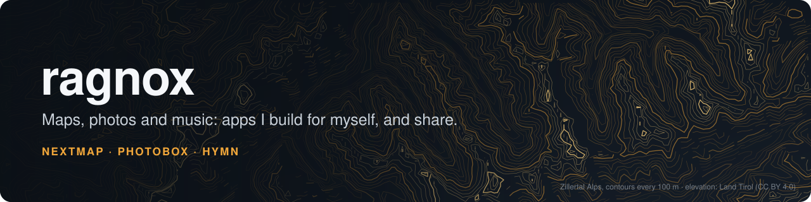
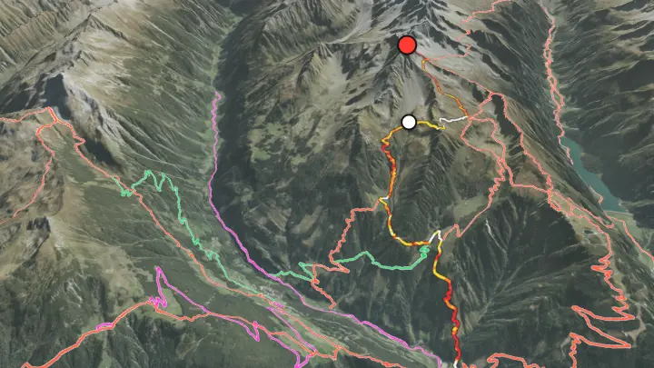
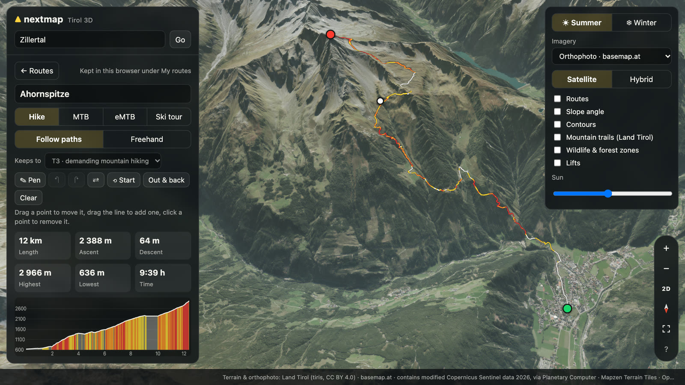
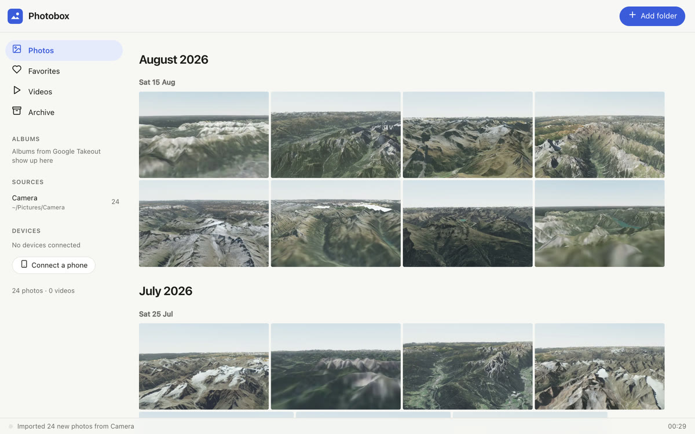
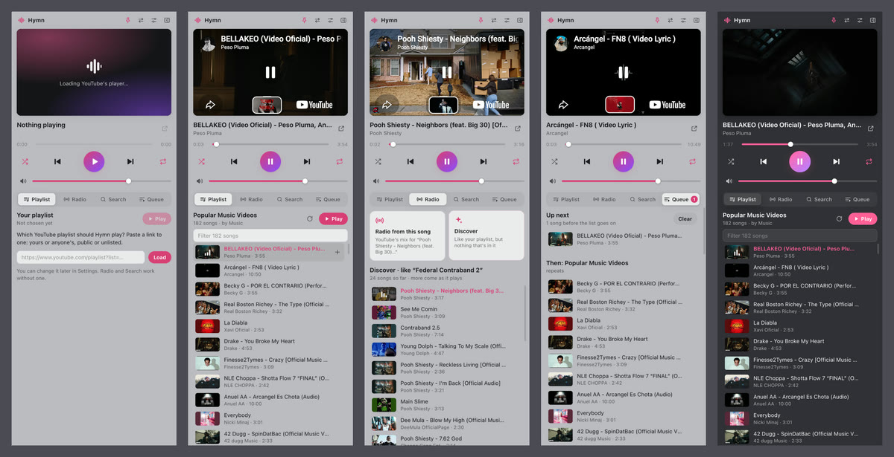
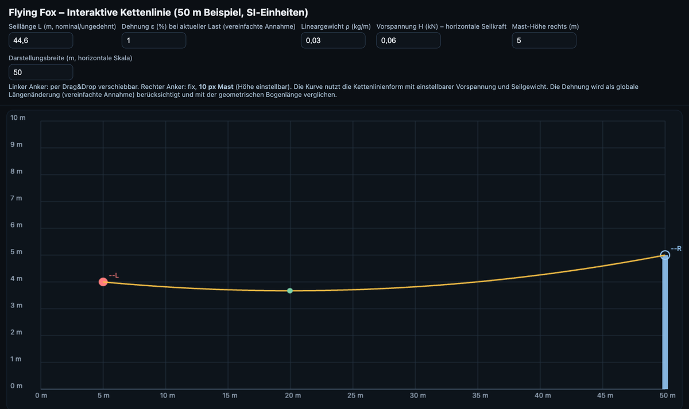

  

  <a href="https://nextmap.pages.dev"><b>Open nextmap</b></a> ·
  <a href="https://github.com/ragnox/photobox/releases">Get Photobox</a> ·
  <a href="https://github.com/ragnox/hymn/releases">Get Hymn</a>

---

## nextmap: a 3D map of Tyrol

The whole of Tyrol in 3D, right in the browser: the Land Tirol laser scan as terrain, 20 cm orthophotos, and Sentinel-2 satellite imagery for summer and winter. Over 14,000 hiking, bike, Bike & Hike and ski-touring routes from OpenStreetMap are on the map, each measured and with an elevation profile.

<table>
<tr>
<td width="56%"></td>
<td>

**Plan your own route.** Click the map and each leg follows roads, tracks and trails: 145,000 km of them, searched right in your browser.

- Hike at T1–T6, ride MTB or eMTB at S0–S5
- Marks where you'd push or carry the bike, or where a path is harder than your grade
- Leave the bike and walk on: Bike & Hike in one route
- Times, profile, GPX, and a link for every route

**[Open the map →](https://nextmap.pages.dev)** · [Code](https://github.com/ragnox/nextmap)

</td>
</tr>
</table>

---

## Photobox: your photo library, on your own disk

<table>
<tr>
<td width="56%"></td>
<td>

Point Photobox at a Google Takeout export or any folder of photos and get a fast timeline with albums, favorites, live photos and videos. It reads the date, place and description that Takeout scatters over its JSON sidecars, keeps watching your folders, and exports everything to a folder you own.

Desktop app for macOS, or in the browser.

**[Download →](https://github.com/ragnox/photobox/releases)** · [Code](https://github.com/ragnox/photobox)

</td>
</tr>
</table>

---

## Hymn: a sidebar music player for macOS

<table>
<tr>
<td>

Hymn docks to the edge of your screen and plays your YouTube playlist, YouTube mixes, search results or any YouTube link you paste. You control it from the sidebar, the menu bar, global shortcuts and the media keys.

**[Download →](https://github.com/ragnox/hymn/releases)** · [Code](https://github.com/ragnox/hymn)

</td>
<td width="56%"></td>
</tr>
</table>

---

## Flying fox calculator

<table>
<tr>
<td width="56%"></td>
<td>

How far does a flying fox sag? Drag the anchor and set the rope's length, stretch, weight and tension, and it draws the catenary with its lowest point, and checks the curve against the rope you have. One HTML file, in German.

[Code](https://github.com/ragnox/flying-fox-calculator)

</td>
</tr>
</table>

---

Map imagery and elevation: Land Tirol (tiris, CC BY 4.0), basemap.at (CC BY 4.0), OpenStreetMap contributors (ODbL). The banner shows the Zillertal Alps as contour lines, every 100 m.
